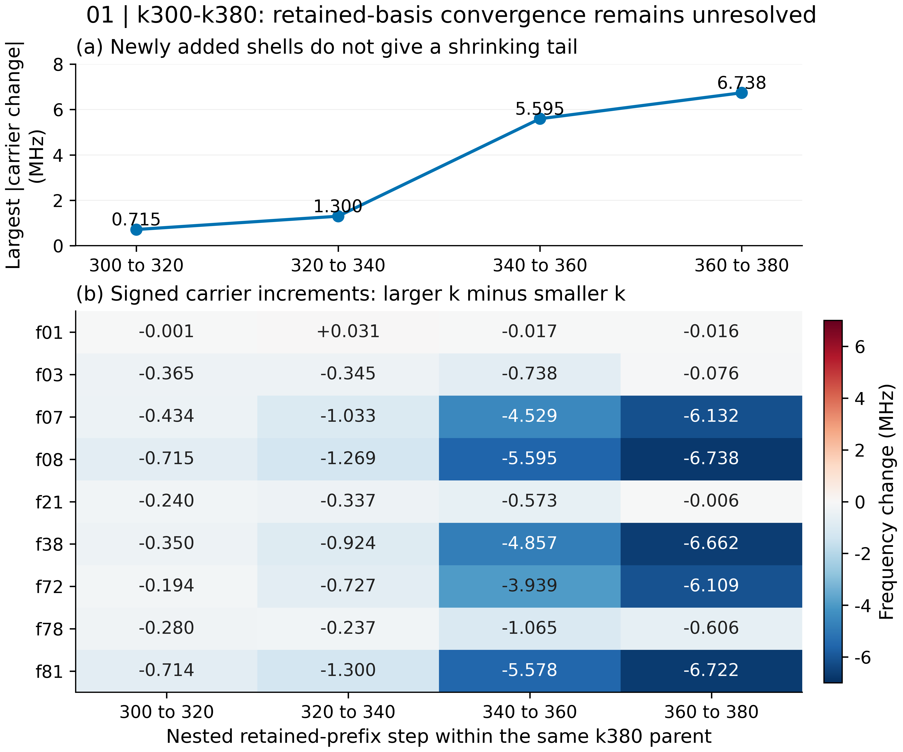
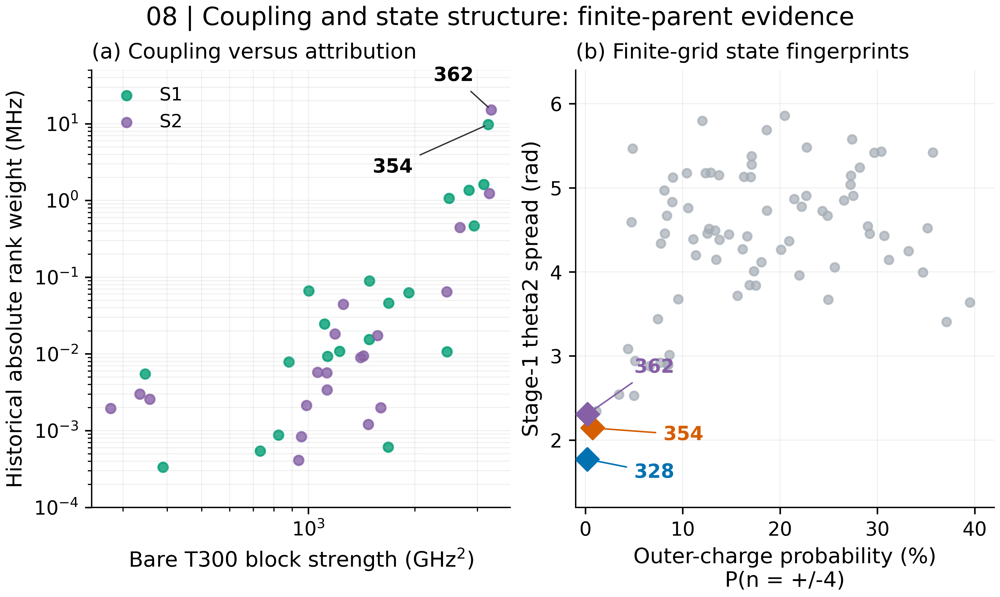
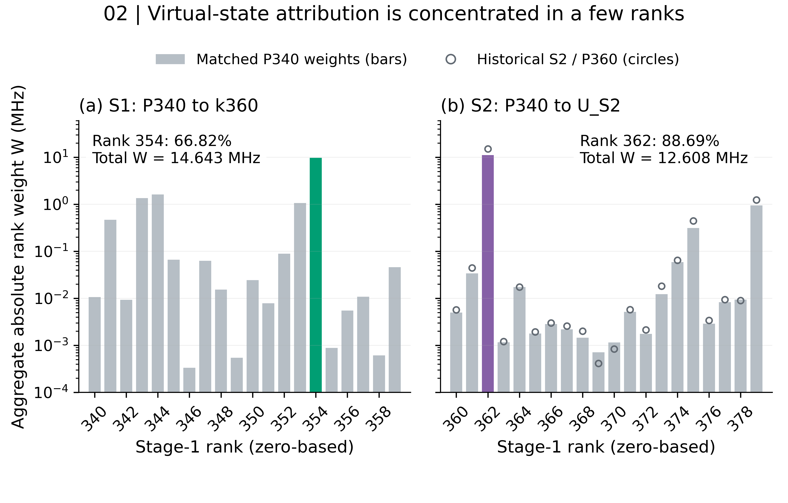
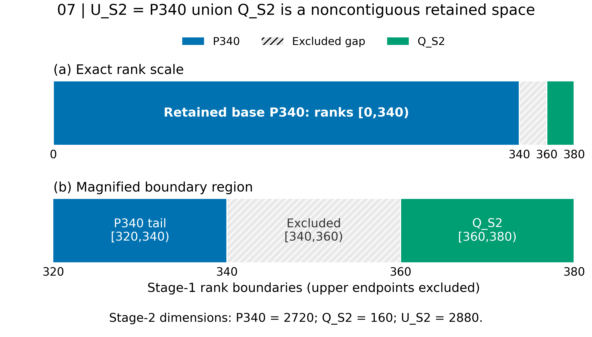
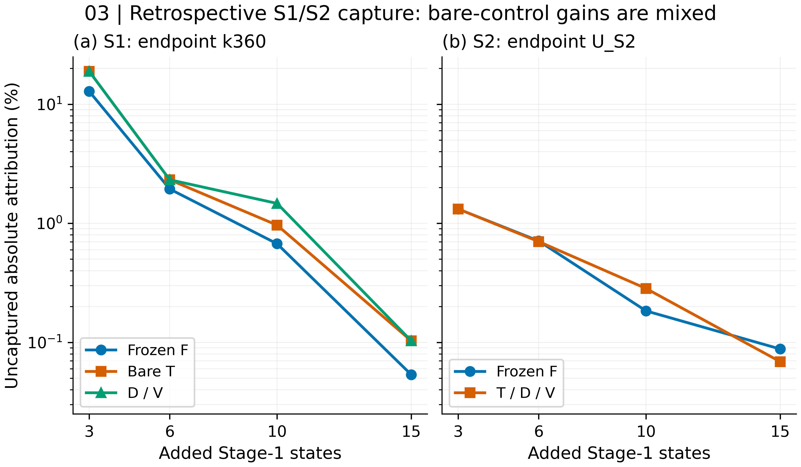
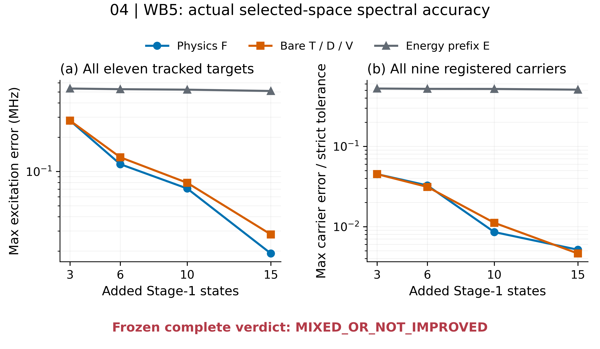
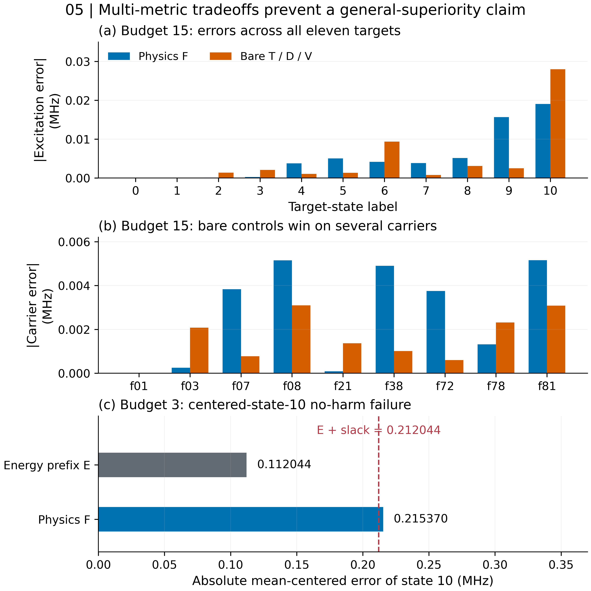
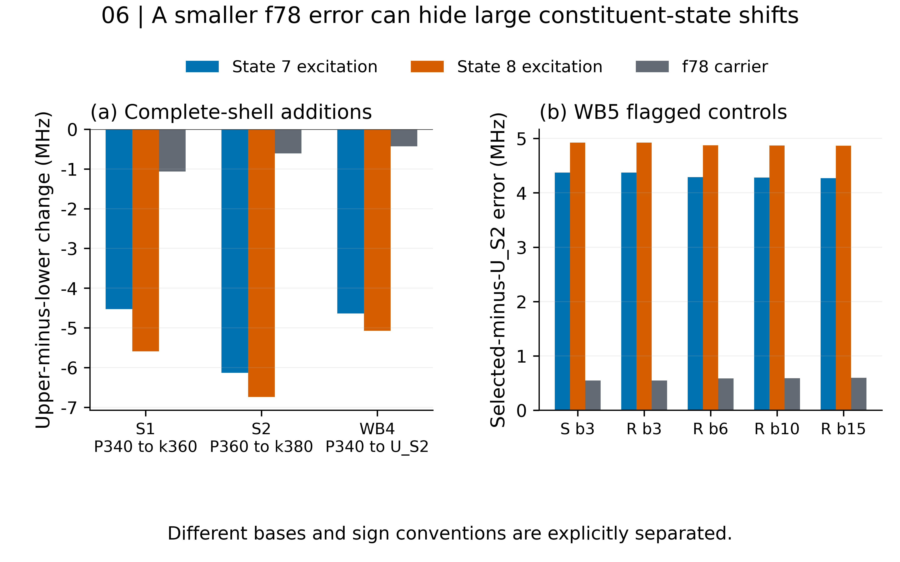

# Gridium: high-rank virtual states and selected-space accuracy

Research update for Thomas Ersevim | October 24, 2026 | Work Blocks 1-5

**Result:** response-aware noncontiguous retention gives accurate spectra against a validated finite reference, but its complete frozen comparison with simple controls remains **MIXED_OR_NOT_IMPROVED**. This is a documentation and saved-data handoff; no new eigensolve was performed.

This update follows the [October 20 research work block](../WORK_BLOCK_2026-10-20.md) and [earlier research overview](../README.md). The October-20 Thomas handoff is preserved. This update consolidates the subsequent coupling, fingerprint, transfer, matched-attribution and spectral-accuracy work. Historical reports retain their original dates/verdicts; later experiments resolve specific earlier gaps without rewriting those records.

## Original question and common model

Can a fixed response-aware selector identify the few high-rank Stage-1 states that matter for the tracked dressed spectrum, and improve accuracy at equal retained-state cost relative to an energy prefix or simple bare-coupling rules?

The authenticated model point is epsilon_J=0.11, epsilon_LK=0.05, N2=N3=71, L2=11 rad, L3=14 rad, n1max=4 and N4=8. The saved Stage-1 parent contains 380 states from a 45,369-dimensional finite representation. Energies represent H/h in GHz; frequency/error plots use MHz without a 2*pi conversion. Stage-1 rank identities are distinct from dressed target-state labels.

The historical physics selector is a frozen target-pair matrix-coverage rule, using base targets and candidate operator/isolated-block response information for pairs (0,1), (2,3), (7,8). It is not a retrospective descending exact-Schur-weight sort. The present report neither regenerates nor refits it. Bare T/D/V controls and all outcome comparisons remain retrospective; the historical local hash/call-order evidence is not an independent timestamp or a prospective validation dataset.

## Observed numerical results

### 1. The k380 spectral tail is unresolved

[Vector PDF](figures/F01_retained_basis_tail.pdf). Full caption and numerical source locators: [Figure 1](FIGURE_CAPTIONS_AND_PROVENANCE.md#figure-1).

Within the same finite k380 parent, the largest adjacent carrier corrections are 0.714572, 1.299836, 5.594546, 6.738198 MHz. High-frequency increments grow substantially in the last shells; f78's increment magnitude is nonmonotonic. The original frozen retained-basis result remains FAIL / D_NONMONOTONIC_UNRESOLVED. Stable overlaps and relatively stable low-state operator elements do not erase the spectral corrections. No extrapolation or tail bound beyond rank 379 is available.

### 2. Coupling and saved-state fingerprints clarify the mechanism

[Vector PDF](figures/F08_coupling_and_state_fingerprints.pdf). Full caption and numerical source locators: [Figure 8](FIGURE_CAPTIONS_AND_PROVENANCE.md#figure-8).

WB1 tested all 35 available frozen predictor classes across S1/S2, including dominant-removed checks. Bare T300 identifies ranks 354 and 362 as shell leaders; its within-shell Spearman associations are 0.809023/0.705263. Its leader-to-runner-up coupling-strength ratios are only about 1.03/1.01, while historical absolute attribution ratios are about 6.04/12.24. Saved target-conditioned coupling data explain that contrast better than the tested scalar bare-denominator reweightings. Those target-conditioned records are explanatory and outcome-adjacent, not independent predictors available for free.

WB2 supplies finite-grid fingerprints for every rank 300-379. Focal ranks 328/354/362 have unusually narrow theta2 spreads and low outer-charge probability. They are not uniformly distinguished by enhanced spatial boundary weight. Their strongest bare partners are intermediate Stage-1 ranks 211/224/230, rather than simply the lowest eleven ranks. Bare block norms sum all oscillator levels; they must not be interpreted as one dressed-target coupling. No shared mode quantum number, cross-grid stability or cutoff error bound is established.

### 3. A few ranks carry most absolute virtual-state attribution

[Vector PDF](figures/F02_rank_resolved_attribution.pdf). Full caption and numerical source locators: [Figure 2](FIGURE_CAPTIONS_AND_PROVENANCE.md#figure-2).

S1/P340 has total absolute attribution 14.642727735 MHz; rank 354 supplies 9.784721460 MHz. Matched S2/P340 has total 12.607858748 MHz; rank 362 supplies 11.181656938 MHz (88.687993%). The historical S2/P360 total is different: 17.011414 MHz, including 15.138874 MHz at rank 362. These numbers cannot be exchanged merely because the candidate ranks are the same.

Here W_r sums absolute signed scalar Schur contributions over targets 0,1,2,3,7,8. It is not a signed transition correction or a counterfactual removal experiment. Full-shell rank scalars already include resolvent mixing; independent-rank additivity is not exact. Dominance of one Stage-1 rank also does not mean one dressed shell eigenmode dominates.

### 4. WB3's base mismatch was resolved by WB4

[Vector PDF](figures/F07_retained_space_partition.pdf). Full caption and numerical source locators: [Figure 7](FIGURE_CAPTIONS_AND_PROVENANCE.md#figure-7).

WB3 validly evaluated the frozen selector on S1, but could not score its P340-based S2 order against P360-based exact labels. WB4 supplied the missing matched construction: P340=[0,340), Q_S2=[360,380), U_S2=P340 union Q_S2, with ranks [340,360) excluded. U_S2 has 360 ranks and Stage-2 dimension 2880; it is not contiguous k360. Its saved eleven eigenpairs and labels passed numerical consistency checks and were reused in WB5 without recomputing the reference.

[Vector PDF](figures/F03_S1_S2_selector_capture.pdf). Full caption and numerical source locators: [Figure 3](FIGURE_CAPTIONS_AND_PROVENANCE.md#figure-3).

Frozen F capture at budgets 3/6/10/15 is 87.150372%, 98.058058%, 99.326400%, 99.946458% for S1 and 98.680013%, 99.289072%, 99.816194%, 99.912058% for matched S2. S1 F outperforms the specified bare/denominator capture controls at every registered budget. S2 ties them at budget 3, is slightly lower at 6/15 and higher at 10. These are compatible retrospective attribution comparisons, not yet spectral-accuracy results or prospective transfer validation.

### 5. WB5 computes the actual selected-space spectra

[Vector PDF](figures/F04_WB5_spectral_accuracy.pdf). Full caption and numerical source locators: [Figure 4](FIGURE_CAPTIONS_AND_PROVENANCE.md#figure-4).

WB5 completed 19 unique sequential eigensolves for 28 method/budget mappings, with eleven target eigenpairs per solve. F, bare T/D/V, energy-prefix E and both spread controls were all evaluated. Identical spaces share one result; F=T=D=V at budget 3 and T=D=V at every budget. All 209 computed eigenpairs passed residual, orthogonality, independent action and target-tracking gates. The maximum residual is 4.216e-13 GHz; minimum assigned overlap is 0.999931577.

Maximum absolute excitation errors over all eleven states (MHz):

| Added states | Physics F | Bare T/D/V | Energy prefix E | F versus E, complete rule |
| ---: | ---: | ---: | ---: | --- |
| 3 | 0.279658 | 0.279658 | 0.535358 | MIXED_OR_NOT_IMPROVED |
| 6 | 0.115900 | 0.133264 | 0.528191 | IMPROVED |
| 10 | 0.070881 | 0.079541 | 0.523126 | IMPROVED |
| 15 | 0.019042 | 0.028006 | 0.509421 | IMPROVED |

Every F space passes the registered strict absolute state/carrier/selectivity thresholds against finite U_S2. At budgets 6/10/15, F has the smallest worst-state excitation error. At budget 3 it shares the winning space with T/D/V. Accuracy is now computed and validated for these selected spaces, replacing the earlier INCOMPLETE status for this specific finite-reference question. It does not change convergence or gate holds.

### 6. The complete frozen decision remains mixed

[Vector PDF](figures/F05_individual_errors_and_frozen_tradeoffs.pdf). Full caption and numerical source locators: [Figure 5](FIGURE_CAPTIONS_AND_PROVENANCE.md#figure-5).

The relative rule requires at least 20% improvement in both the maximum excitation and normalized carrier envelopes, no component harmed beyond 0.1 strict units, and no flagged physics cancellation. F passes against energy-prefix at budgets 6,10,15, but not at 3: its centered state-10 error 0.215369846 MHz exceeds the E value 0.112044262 MHz plus the 0.1-MHz slack by 0.003325584 MHz. Both envelopes improving is insufficient under the unchanged rule.

Against T/D/V, budget 3 is an identical-space tie. Excitation reductions at 6/10 are approximately 13.0%/10.9%, below the required 20%. At budget 15 the worst-state reduction is approximately 32.0%, but the normalized carrier envelope is worse. T/D/V have the smaller carrier envelope at budgets 6 and 15. At budget 15 they are also better on individual states 4,5,7,8,9 and multiple carriers. None of these unfavorable components is omitted or used to retune criteria.

The frozen aggregate verdict is **MIXED_OR_NOT_IMPROVED**. This is compatible with useful absolute accuracy and evidence for noncontiguous compression; it does not support consistent superiority over simple bare selection.

### 7. Dressed-frequency cancellation must remain explicit

[Vector PDF](figures/F06_frequency_cancellation.pdf). Full caption and numerical source locators: [Figure 6](FIGURE_CAPTIONS_AND_PROVENANCE.md#figure-6).

WB4 adds the isolated S2 shell and changes constituent excitations by -4.640170316 and -5.070939122 MHz, yet f78 changes only -0.430768806 MHz. WB5 flags five spread/reverse-spread control cases where roughly 4-5 MHz constituent errors yield much smaller f78 differences; none of F/T/D/V is flagged. Thus a small splitting error cannot certify the participating excitation energies. f01, f78, their selectivity difference, all other carriers and all eleven state errors remain separate mandatory observables.

### 8. Measured cost and authentication

The single guarded WB5 execution took 213.312670 s through final publication, with sampled peak worker-group RSS 1,501,085,696 bytes (1.397995 GiB). All 70 numerical output-manifest entries and all source/delivery hashes authenticate. Cleanup was verified. Shared reference loading and unique-cell costs are distinguished from aliases. Historical candidate-screening/base-preparation allocations remain unavailable, so no measured end-to-end speedup is established. Sampled RSS is not a continuous or kernel-enforced peak bound.

The original October 24 sandbox handoff authenticated the WB1-5 records, verified all 847 WB5 source pins, reproduced all 36 plotted historical carrier increments from primary saved spectra, and snapshotted 2724 existing files including 95 figures. This GitHub review copy preserves its numerical data and figures; preparation of this copy involved file authentication and Markdown navigation changes only. It performs no research eigensolve, Hamiltonian assembly, new Schur contraction or propagation. See [authentication](EVIDENCE_AUTHENTICATION.json), [source hashes](SOURCE_PROVENANCE.json), [numerical evidence table](NUMERICAL_EVIDENCE_AND_LIMITATIONS.md), and [visual QA](FIGURE_VALIDATION_AND_READABILITY.md).

## Physical interpretations

**Supported interpretation:** strong but off-resonant operator overlap with a small number of high-rank directions can shift low dressed energies by MHz while vector overlaps remain near unity. Narrow finite-grid theta2 structure and substantial coupling to intermediate retained partners are consistent with concentrated virtual response. The saved exact Schur identity separates self-energy and P-space relaxation, so self-energy alone is not the full energy shift.

**What remains unestablished:** a shared normal-mode assignment; which dressed operator-channel interference causes the full effect; state stability under changed cutoffs/grid/domain; cross-parent identity for ranks 354/362; a bound on unseen ranks; independent physical validation of the common model. Bare scalar denominators do not by themselves explain the attribution hierarchy, but that does not remove denominators from the physics of virtual response. These are finite-parent explanatory observations rather than causal or prospective proof.

## Proposed future work

Preregister an independent finite-parent transfer experiment of the unchanged F selector against frozen T/D/V and energy/spread controls. Freeze the new parameter/base/shell/target identities and all criteria before viewing candidate outcome spectra. Evaluate all eleven states, all carriers, selectivity and cancellation, with complete fresh screening/base/reference/selected-space timing. Generalization under the full rule, rather than another favorable maximum-error curve alone, would strengthen the contribution. A repeat mixed outcome would support accurate compression without a claim of unique selector advantage.

The [short proposal](NEXT_TRANSFER_EXPERIMENT.md) specifies the required evidence and scope boundary. It is not implemented, launched or authorized here.

**Scientific claim limits:** no general superiority; no end-to-end speedup; no spatial or retained-basis convergence; no demonstrated asymmetric four-mode gate. Schur-v2 prelaunch: **HOLD**. Gate work: **HOLD**. Spatial convergence: **HOLD**.
