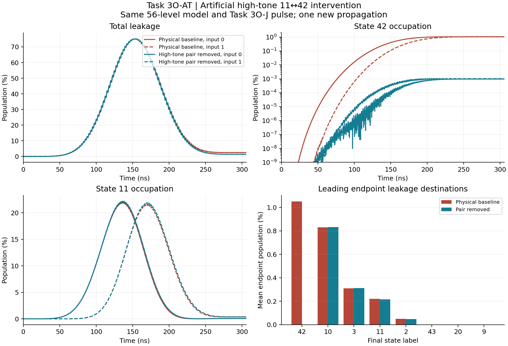
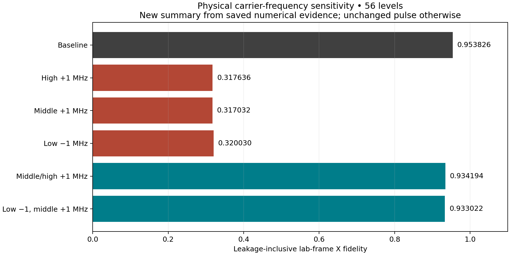
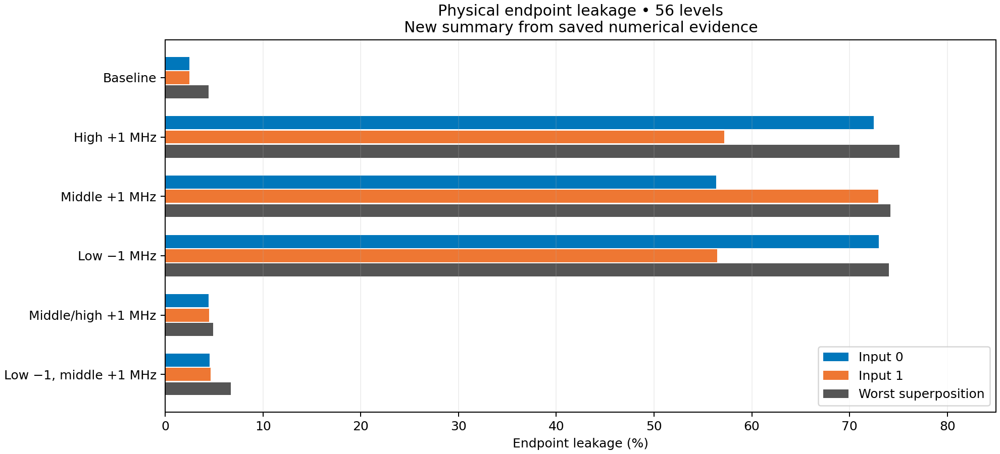
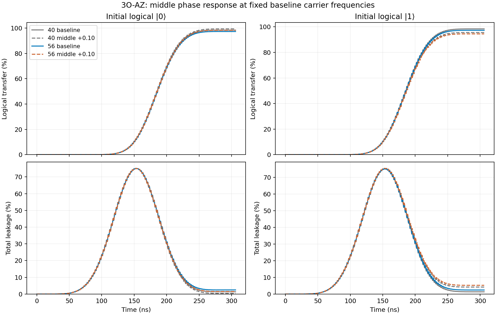
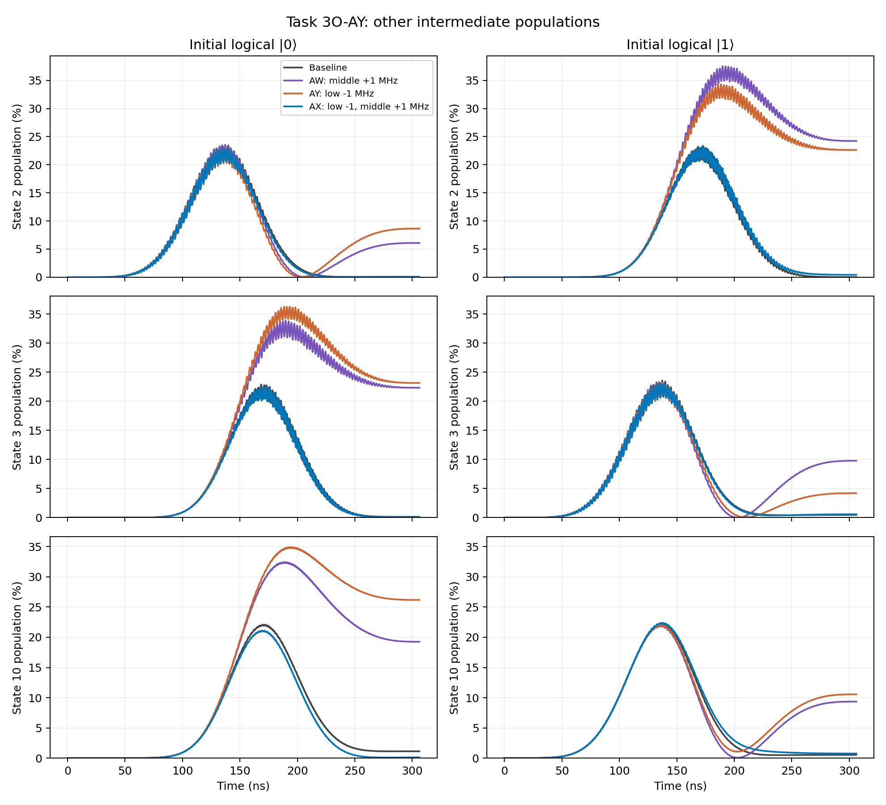

# Three-tone Gridium control: leakage, frequency coordination and phase response

**November 24 work block, continued November 25, 2026 — CLOSED by MAIN CHAT.** Prepared for Thomas from authenticated saved evidence. Publication only: no new propagation, eigensolve, coupled calculation or optimization.

## Model and numerical scope

ACTIVE symmetric four-mode model: Stage-1 retention k=280, N2=N3=61, N4=12 and 56 final states, with accepted physical ordering and logical gauge. The fixed 306.1862178478972 ns Task 3O-J pulse uses g(t)=2 sin²(πt/T). Baseline carriers are 2.5578188528877828, 2.9600270704289056 and 5.517845923316688 GHz. All physical tests retain the complete complex Hermitian grid_phi operator. Only AT deliberately modifies the high-tone operator.

Primary fidelity is leakage-inclusive lab-frame F=[Tr(M†M)+|Tr(X†M)|²]/6, X=−iσx, with no fitted phases or loss normalization. Interaction-frame results are separate diagnostics in the packaged comparisons. Worst leakage is the largest eigenvalue of K†K, not the larger basis-input leakage. Completed calculations passed norm/unitarity checks below 1e−7; numerical acceptance does not imply model convergence. The original AY timeout remains preserved locally and contributes no scientific data; AY here denotes its separately authorized completed attempt.

## Dominant added leakage coupling: artificial diagnostic (3O-AT)

Removing only the high-tone G[11,42] and its Hermitian conjugate raises fidelity **0.953826187395 → 0.964109902508**. Worst superposition leakage falls **4.431659% → 2.326425%**. State-42 endpoint populations fall from **1.044294% / 1.056765%** to **0.000963% / 0.001024%**, for initial logical 0 / 1. This recovers **95.5961% (95.60%) of the additional 40→56 fidelity loss**, using the 40-level reference 0.964583651799.

This is an **artificial Hamiltonian intervention, not a physical gate improvement**. It establishes a dominant coupling contribution under this fixed pulse, not a unique microscopic pathway: the intervention can change population transfer, dressing and interference together. Other tones and other couplings remain active. The original figure shows substantial transient excitation followed by improved endpoint return.

## Physical carrier coordination: AU–AY

| Physical configuration | Lab X fidelity | Worst endpoint leakage |
|---|---:|---:|
| Baseline | 0.953826187395 | 4.431659% |
| High +1 MHz (AU) | 0.317636188328 | 75.085203% |
| Middle +1 MHz (AW) | 0.317031652371 | 74.165852% |
| Low −1 MHz (AY) | 0.320029966643 | 74.041122% |
| Middle + high +1 MHz (AV) | 0.934194356139 | 4.877309% |
| Low −1 + middle +1 MHz (AX) | 0.933021988061 | 6.684436% |

Single-carrier shifts severely disrupt coherent return; two independent compensated combinations largely recover it. The association follows f_low+f_middle−f_high≈0: mismatch is 0 for baseline/AV/AX, −1 MHz for AU/AY and +1 MHz for AW. Neither single-shift input persistently returns below 10% total leakage after its global peak. Baseline returns at 226.203 / 226.203 ns, AV at 230.452 / 230.702 ns and AX at 229.702 / 231.952 ns on the saved approximately 0.25 ns grid.

The middle–high interaction contrast F_AV−F_AW−F_AU+F_baseline is **+1.253352702835**; the low–middle contrast F_AX−F_AY−F_AW+F_baseline is **+1.249786556442**. Contrasts measure nonadditivity and may exceed one; they are not probabilities. AY/AW transfer imbalances are −17.333294 / +17.670225 percentage points, whereas AX and AV nearly restore equal logical transfers.

**Carrier-sum matching is not sufficient for high fidelity and is not uniquely causal here.** Individual transition detunings (Δ=transition−carrier), accumulated phases and off-resonant couplings change together. AX and AV have similar fidelity but different worst leakage (6.684436% versus 4.877309%) and leakage Grams. State-42 endpoint populations are 1.257288% / 1.064726% in AX versus 0.922202% / 0.817701% in AV. This residual structure matters even after frequency compensation. These are fixed-pulse sensitivity tests, not pulse optimization.

The next two figures are **new summary figures generated only from the authenticated saved numerical comparisons**; they contain no invented time-series data.

## Middle-phase response at unchanged detunings (3O-AZ)

Only middle_phase=baseline_phase+0.10 rad changes, from −1.9229062786507711e−13 to 0.09999999999980771 rad. All carrier frequencies, detunings, amplitudes, other phases and pulse timing stay baseline.

| Final levels | Baseline lab fidelity | +0.10 rad lab fidelity | Change |
|---|---:|---:|---:|
| 40 | 0.964583651799 | 0.955314191778 | −0.009269460021 |
| 56 | 0.953826187395 | 0.944510283961 | −0.009315903434 |

At 56 levels, transfers become **98.272157% / 94.495537%**, with **+3.776620 percentage-point imbalance**, consistent in direction with +3.823256 at 40 levels. Worst leakage rises **4.431659% → 6.114036%**. The 56-level lab-fidelity response magnitude is only 0.5% larger; imbalance and incremental worst-leakage responses are smaller. The loss/anisotropy benchmark increases 0.009347356153 while the fixed-loss coherent penalty decreases 0.000031452719: the algebraic change is dominated by endpoint loss/anisotropy, not a clean logical-phase correction.

State-42 endpoints become 1.046026% / 1.093276%, small increases of 0.001732 / 0.036511 percentage points. State 42 is absent at 40 levels; adding sixteen states together does not isolate its causal influence. The evidence supports **phase-dependent multistate coherent return at unchanged detunings**, not a unique interference mechanism.

## Intermediate populations and remaining limitations

The original AY figure below shows large transient intermediate occupation and contrasting endpoint return for baseline/AW/AY/AX. State populations and leakage Grams, full complex logical maps, phases and return timings are retained in the packaged numerical comparisons. Times are sampled diagnostics, not continuous-time extrema or integrated carrier-current attribution.

Stage-1 convergence remains unresolved. Spatial convergence remains unresolved. grid_phi is an **uncalibrated exploratory control operator**. There is no decoherence or asymmetric-device validation and no experimental hardware-performance claim. Final-level persistence through these checkpoints does not establish full numerical convergence. The artificial diagnostic must not be conflated with physical pulse performance.

## Next experiment — NOT EXECUTED

One 56-level propagation with all baseline parameters unchanged except **middle_phase=baseline_middle_phase−0.10 rad**. Compare with the saved baseline and +0.10 result to test the approximately odd logical-input imbalance response and the even component of leakage/fidelity response. No sweep, fitted phases or optimization. **This experiment was not executed during this work block or publication.**

## Evidence and closure

See [MANIFEST.md](MANIFEST.md) for sources, figure provenance and SHA-256 hashes, and [evidence/](evidence/) for numerical comparisons. Original sandbox packages and historical failures remain unchanged; they retain their contemporaneous OPEN status as historical records. This publication and the single November 24 log entry record MAIN CHAT's subsequent closure. No separate November 25 daily entry is created.
